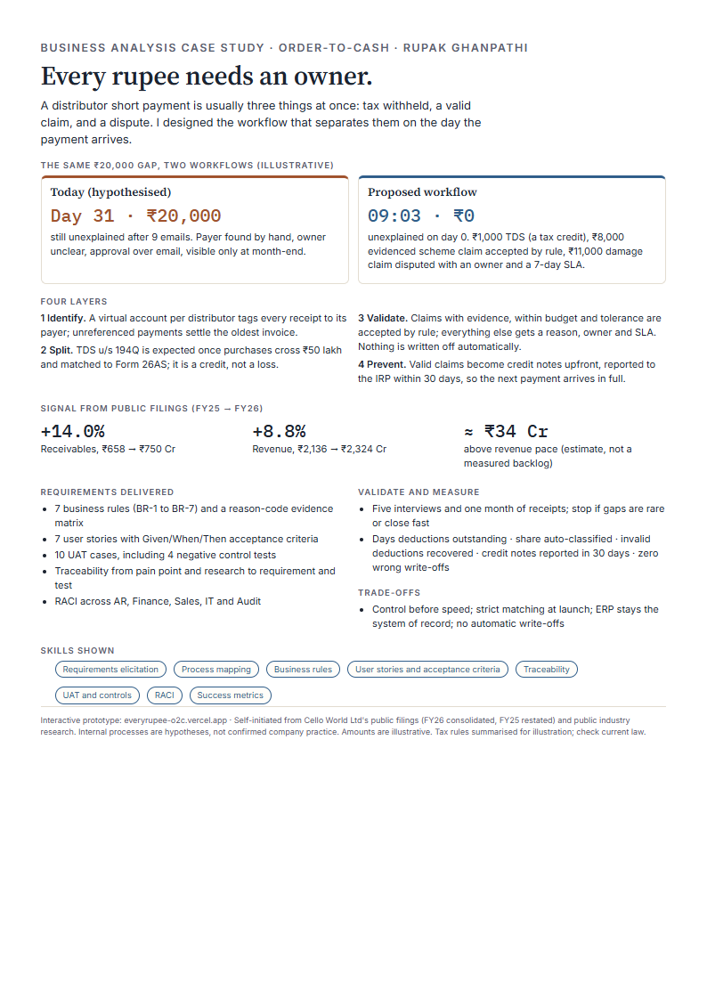

# Every rupee needs an owner: an order-to-cash case study

> **Live page:** [everyrupee-o2c.vercel.app](https://everyrupee-o2c.vercel.app) · Product case study by **Rupak Ghanpathi** · built from Cello World Ltd's public filings

In Indian distribution, a short payment is usually three things at once: tax withheld, a valid claim, and a dispute. Most teams treat it as one. This case study designs the workflow that separates them, proves what's valid, and prevents the next gap.

**[Read the full case study (PDF)](Cello_O2C_Case_Study.pdf)** · **[One-pager (PDF)](Cello_O2C_One_Pager.pdf)**

## Why it matters
| Metric (FY25 to FY26) | Change |
| --- | --- |
| Trade receivables, ₹658 Cr to ₹750 Cr | **+14.0%** |
| Revenue, ₹2,136 Cr to ₹2,324 Cr | +8.8% |
| Receivables above revenue-pace growth | **approx. ₹34 Cr** (an estimate, not a measured backlog) |

## What the live page shows
A business analysis chain on one page: problem and scope (including what's out of scope) → as-is vs to-be prototype → business rules (BR-1 to BR-7) → traceability from pain points and research to requirements and UAT → user stories with Given/When/Then and RACI (collapsible) → decisions and trade-offs → success metrics and validation plan.

## The design: four layers
1. **Identify.** Each distributor pays into its own virtual account, so every receipt is tagged to the payer. Unreferenced partial payments settle the oldest open invoice first.
2. **Split.** Statutory withholding (TDS u/s 194Q; GST-TDS for notified buyers) is separated from commercial deductions. TDS is a credit to match in Form 26AS, not a loss.
3. **Validate.** Reason code → required evidence → validity rule. Evidenced, in-budget claims under a Finance-set tolerance are auto-accepted; unexplained gaps are never written off automatically.
4. **Prevent.** Valid claims are settled upfront as credit notes, with IRP reporting (30 days) and Section 34 deadlines built into the SLA. Ageing disputes flag the distributor's next order for credit review.

Kept from the original design: a case with reason code and owner, SLA routing, maker-checker above threshold, ERP as system of record, full audit trail.

## What the research added
| Finding (source) | How the design answers it |
| --- | --- |
| TDS treated as a loss is a leading cause of reconciliation differences (invoicedataextraction.com guide) | The Split layer tracks each distributor's running purchases, expects the 194Q TDS line, and classifies it as a Form 26AS credit |
| Unstructured claims can over-pay 5–12% of scheme spend (Terra Insight) | Scheme claims are valid only with evidence and within that distributor's scheme budget |
| 90–95% of deduction value is typically valid; 5–10% invalid (HighRadius) | "Make the 90% boring": auto-accept evidenced, in-budget claims; people work only the exceptions |
| Average dispute resolution about 41 days; 44% of companies have no resolution deadline (HighRadius; Attain Consulting 2021 survey) | Every dispute gets an owner and an SLA on day 0, with escalation on breach |
| Missed credit-note windows leak GST (Terra Insight example, illustrative) | IRP 30-day and Section 34 deadlines are part of the SLA |
| Virtual accounts tag each payment to its payer automatically (open.money) | The Identify layer removes manual payer identification from bank narrations |

## Repo map
- `site/` — the live page (static HTML, CSS, JS; deployed on Vercel with Root Directory `site`)
- `Cello_O2C_Case_Study.pdf`, `Cello_O2C_One_Pager.pdf` — the original documents

## Skills shown
Problem framing · stakeholder analysis · process design · user stories and acceptance criteria · controls and UAT · success metrics

---
*Self-initiated case study from Cello World Ltd's public filings (FY26 consolidated, FY25 restated) and public industry research. Internal processes are hypotheses, not confirmed company practice. Tools named are proposals, not claims about Cello's systems. Tax rules are summarised for illustration and change; check current law.*
