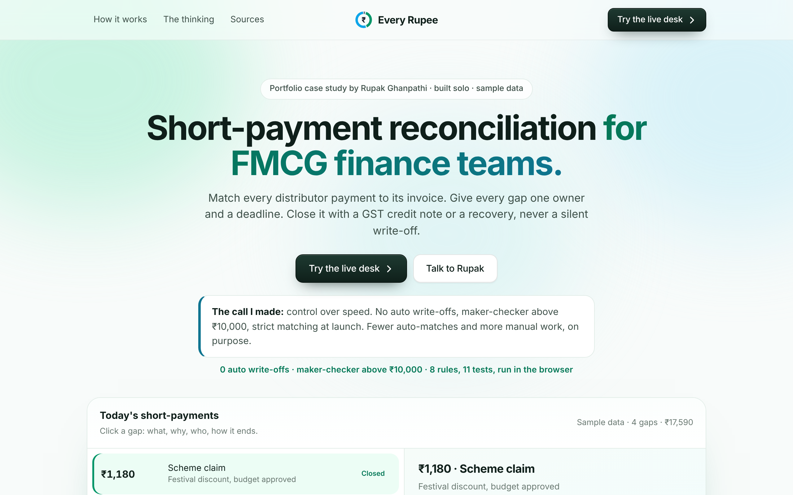

# Every Rupee: short-payment reconciliation for FMCG finance teams

> **Interactive product version:** https://every-rupee-gets-owner.lovable.app · code: https://github.com/RUPAK30/every-rupee-gets-owner

> **Live prototype:** [everyrupee-o2c.vercel.app](https://everyrupee-o2c.vercel.app) · **Try the desk:** [/desk.html](https://everyrupee-o2c.vercel.app/desk.html) · Portfolio case study by **Rupak Ghanpathi**, built solo, sample data

Distributors pay less than the invoice. The gap lands in accounts receivable with no reason and no owner. Every Rupee matches each payment to its invoice, gives every gap one owner and a deadline, and closes it with a GST credit note or a recovery, never a silent write-off.

## The call I made
**Control over speed.** No auto write-offs, maker-checker above ₹10,000, strict matching at launch. That means fewer auto-matches and more manual work, on purpose: in finance ops, a wrong closure costs more than a slow one.

**What I got wrong:** v2 was a wall of text, so I rebuilt it as something you can run, because a spec nobody executes isn't a spec.

## Why now
- **Receivables outgrew revenue.** Cello World's trade receivables rose 14.0% (₹658 → ₹750 Cr) against 8.8% revenue growth (₹2,136 → ₹2,324 Cr), FY25 → FY26: about ₹34 Cr above revenue pace. *My estimate from annual reports; a reason to look, not a diagnosis.*
- **Thin distributor margins.** Distributors earn ₹3.5–5 per ₹100 (AICPDF, Jun 2026), so they recover slow claims by deducting.
- **New GST rule from 1 Nov 2026.** GST on an after-sale discount comes back only through a GST credit note the distributor reverses (Finance Act 2026, CBIC Notification 03/2026). *Summarised; check with a CA.*

Full sources and what the project does not claim: [sources.html](https://everyrupee-o2c.vercel.app/sources.html)

## What's in it
| | |
|---|---|
| **The desk** | Load a sample bank statement (or upload a CSV, read only in your browser), classify short-payments, work cases as Asha in AR, approve, issue credit notes, see the audit trail |
| **9 business rules** | BR-1 to BR-9: payer matching, TDS split, scheme and damage validation, maker-checker, balanced ledger postings, GST credit notes, escalation of unbudgeted schemes |
| **15 UAT tests** | Run in the browser in one click, including the cases that must be blocked: [desk.html?uat=1](https://everyrupee-o2c.vercel.app/desk.html?uat=1) |
| **Lender mode** | [lender.html](https://everyrupee-o2c.vercel.app/lender.html): NACH returns classified by NPCI reason code, penal charges kept separate (RBI, Aug 2023), SMA buckets, maker-checker on waivers; 5 rules, 12 tests |
| **Ledger** | Every receipt, TDS line and credit note posts a balanced voucher; journal exports as CSV |
| **Documents** | [BRD (PDF)](site/Cello_O2C_BRD.pdf) · [One-pager (PDF)](site/Cello_O2C_One_Pager.pdf) · [Case study](https://everyrupee-o2c.vercel.app/case-study.html) |

## Where it could fail
| Risk | Design answer |
|---|---|
| Distributors keep paying the old account | Old account stays open a quarter; Sales gets a weekly list |
| Scheme rules change mid-quarter | No dates and budget from Sales, no valid scheme; the rest goes to a person |
| Sales overrides the credit flag | The flag never blocks an order; overrides are logged by name |

## Honest limits
- Not used by any brand. Not affiliated with Cello World; internal processes are hypotheses from public information.
- No ERP or bank connection; no GST filing. Sample data only.
- No sign-up, no analytics, no tracking.

## Run locally
Static HTML, CSS and JavaScript, no build step: open `site/index.html`, or serve `site/` with any static server.

---
Rupak Ghanpathi · Business Analyst, ex-HDFC Bank · [Portfolio](https://rupak-lemon.vercel.app) · rupakr2g@gmail.com
